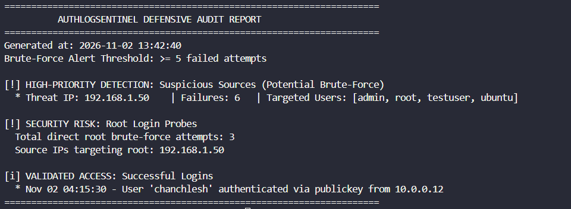

# AuthLogSentinel - Lightweight Defensive Log Analyzer

A Python-based defensive security tool designed to parse Linux authentication logs (auth.log), detect potential brute-force attacks, track unauthorized root access attempts, and audit successful authentications.

This project was built to fulfill Task 13: Build a Small Defensive Security Tool from the Cybersecurity Assessment Task Catalogue.

---

## Features

- Automated Regex Parsing: Efficiently scans standard syslog/auth log formats for SSH authentication events.
- Brute-Force Attack Detection: Groups failed attempts by source IP and flags IP addresses that exceed a configurable threshold.
- Root Target Highlighting: Flags high-risk authentication probes directed specifically at the root account.
- Access Verification: Summarizes valid logins with authentication methods (e.g., password, public key).
- Zero External Dependencies: Built entirely with Python's standard library (re, argparse, collections, datetime).

---

## Repository Structure

- log_sentinel.py: Core defensive log analysis script.
- test_auth.log: Synthetic authentication log containing both benign events and brute-force attack vectors.
- requirements.txt: Environment and dependency details.
- README.md: Project documentation and execution instructions.

---

## Getting Started

## Prerequisites

- Python 3.8 or higher installed.
- Git installed (for cloning the repository).

## Installation

1. Clone this repository:

   ```bash
   git clone https://github.com/chanchu88/AuthLogSentinel.git
   ```

2. Navigate to the project directory:

   ```bash
   cd AuthLogSentinel
   ```

3. No third-party Python packages are required.

## Usage

Run the script by passing the path to the target authentication log file:

```bash
python3 log_sentinel.py <path_to_log_file> [-t THRESHOLD]
```

### Command-Line Options

| Option | Description | Default |
|---|---|---|
| `log_file` | Path to the authentication log file | Required |
| `-t`, `--threshold` | Minimum failed login attempts required to trigger a brute-force alert | `5` |

### Example

```bash
python3 log_sentinel.py test_auth.log -t 5
```

## Verification & Test Results

The tool was tested using a synthetic authentication log dataset (`test_auth.log`).

### Test Dataset Highlights

**1. Suspicious Source – `192.168.1.50`**
- 6 consecutive failed password attempts.
- Targeted usernames: `root`, `admin`, `ubuntu`, and `testuser`.
- Expected detection: Potential brute-force activity.

**2. Successful Authentication – `10.0.0.12`**
- 1 failed password attempt.
- Followed by a successful public key login for user `chanchlesh`.
- Expected detection: Successful login activity.

**3. Failed Authentication – `203.0.113.88`**
- 2 failed login attempts targeting user `git`.
- Expected detection: Below the default brute-force threshold.

### Output Sample

Run the command below to generate the audit report:

```bash
python3 log_sentinel.py test_auth.log -t 5
```




The report identifies suspicious IP addresses, potential brute-force attempts, root login probes, and successful logins.

## Project Repository

[AuthLogSentinel – GitHub](https://github.com/chanchu88/AuthLogSentinel.git)

